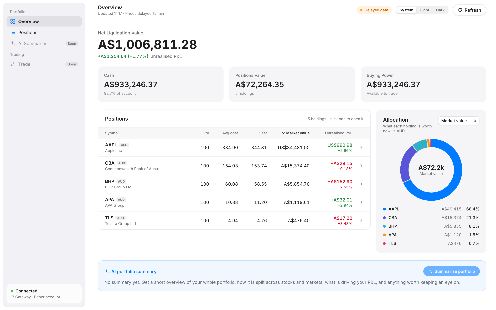
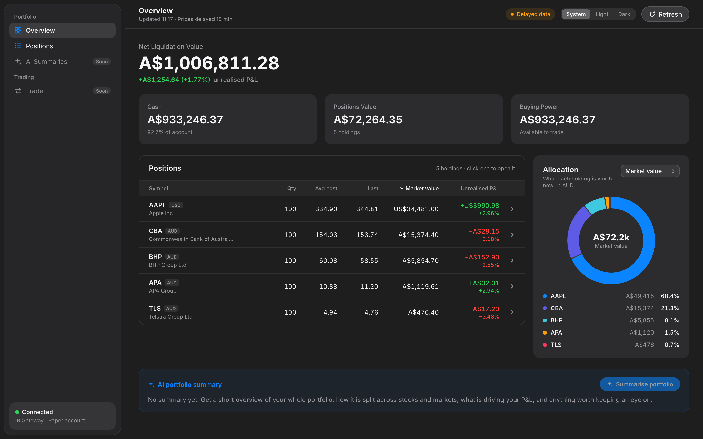
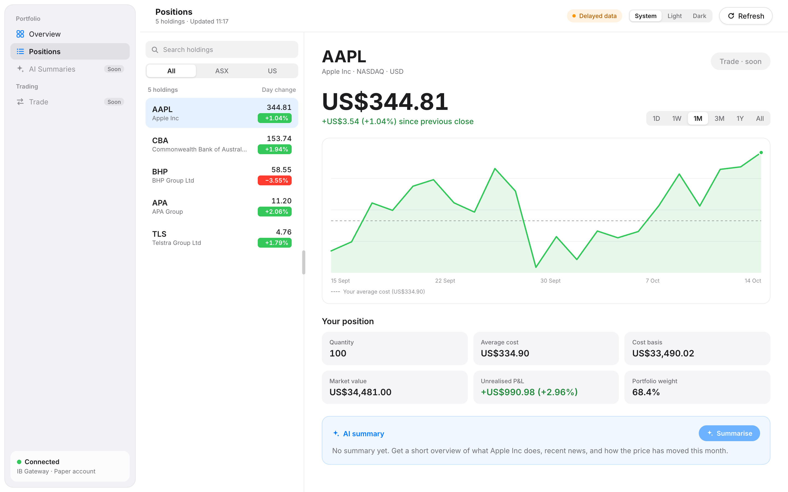
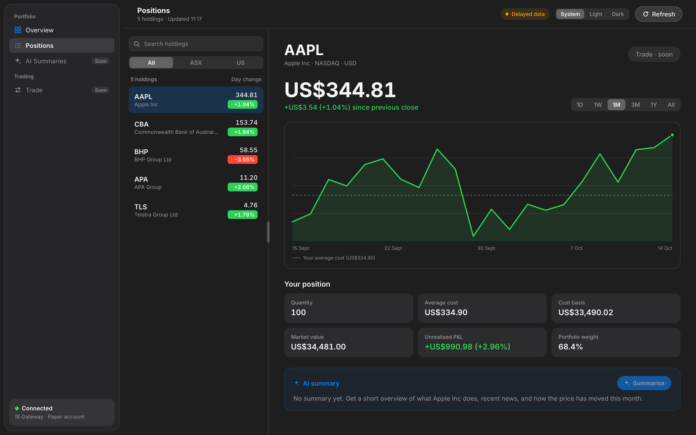
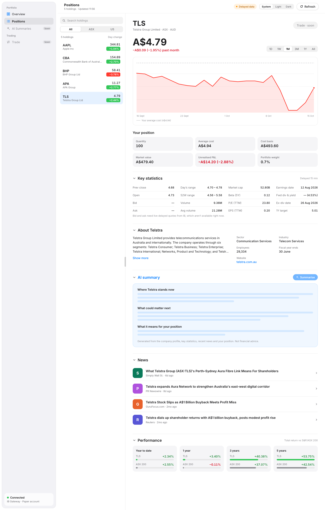
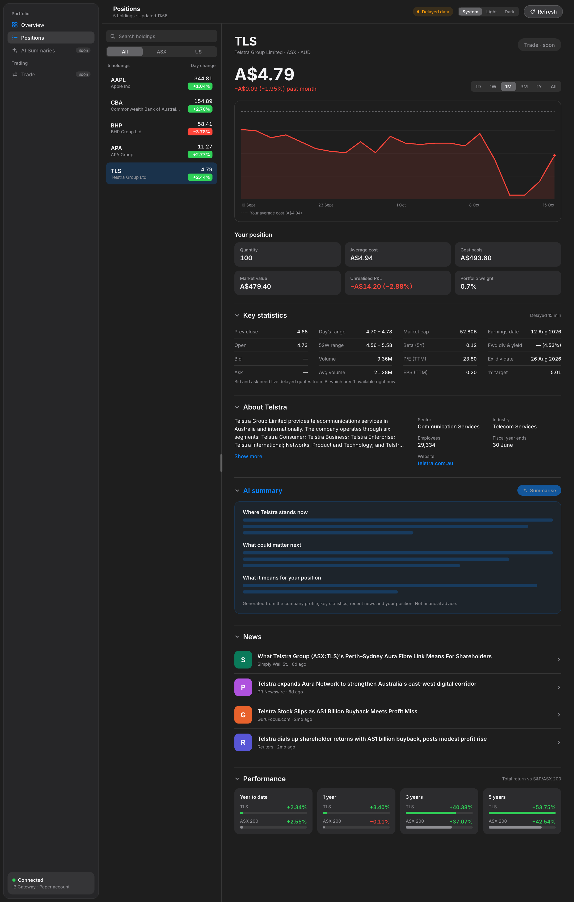

# IBKR Portfolio Manager

A cleaner, more intuitive portfolio dashboard for Interactive Brokers, with AI generated stock summaries.

Interactive Brokers is a powerful broker, but its native interface is dense and hard to navigate. This project connects directly to IBKR through IB Gateway and presents your portfolio in a simpler, modern web interface.

> **Status:** Dashboard and expanded stock detail working. AI summaries are next.

## Screenshots

| | Light | Dark |
|---|---|---|
| **Overview** |  |  |
| **Positions** |  |  |

**Stock detail** (Positions screen, scrolled):

| Light | Dark |
|---|---|
|  |  |

*Paper trading account; prices delayed about 15 minutes.*

## Features

### Working now
* Overview: net liquidation value, cash, buying power and total unrealised P&L
* Sortable positions table (money columns compared in AUD, so US and ASX holdings sort correctly)
* Allocation card that switches between market value, cost basis, quantity and unrealised P&L
* Positions screen: searchable holdings list with an All / ASX / US filter and a resizable sidebar
* Price chart per holding (1D to All) with your average cost marked and the return for the selected range
* Stock detail sections you can expand or collapse (remembered): key statistics, company profile, news, and total return vs the ASX 200 or S&P 500 over YTD, 1, 3 and 5 years
* Light, dark or system appearance
* Refreshes every 60 seconds, and recovers on its own if IB Gateway disconnects and comes back

* AI stock summary (Claude): a 10-part briefing on any holding, covering the business, financial health, valuation, a news digest, why the price moved, upcoming events, bull and bear case, key risks, what it means for your position, and why the price moved since your last summary (in line with the market given the stock's beta, or company specific, with any news from that window). It only uses data the app fetched, cites a source for every point, and never gives buy/sell advice
* Summary history: reopen any of the last 20 summaries of a stock, or compare two side by side, with the exact changes in the data (price, P/E, analyst target, dividend yield, P&L, new news) and each point tagged as new, changed or no longer present

### Planned
* AI summary of the whole portfolio
* Place trades directly from the app
* Mac app that sets up and runs IB Gateway itself (Milestone 7, in progress)

## Roadmap

* [x] **Milestone 1:** Connect to IB Gateway (paper trading account)
* [x] **Milestone 2:** Backend REST API exposing account and position data
* [x] **Milestone 3:** Minimal React UI
* [x] **Milestone 4:** Polished UI
* [x] **Milestone 4.5:** Expanded stock detail (key statistics, company profile, news, performance via yfinance)
* [x] **Milestone 5:** AI stock summaries via the Claude API
* [x] **Milestone 5.1:** Summary history and compare
* [ ] **Milestone 6:** Trade placement
* [ ] **Milestone 7:** Mac app (Tauri): bundled backend, Keychain, Gateway setup and login, DMG

## Tech Stack

| Layer | Technology |
|---|---|
| Broker connection | Interactive Brokers IB Gateway |
| Backend | Python 3.11, [FastAPI](https://fastapi.tiangolo.com/), [ib_async](https://github.com/ib-api-reloaded/ib_async) (the maintained successor to ib_insync) |
| Extra market data | [yfinance](https://github.com/ranaroussi/yfinance) (Yahoo Finance) for company info, fundamentals, news and long-term performance |
| Frontend | [React](https://react.dev/) with [Vite](https://vite.dev/), plain CSS, hand-drawn SVG charts |
| AI summaries | Claude API (Haiku) |
| Mac app | [Tauri 2](https://tauri.app/) (Rust) wrapping the React frontend |

## Architecture

```
React frontend  <-->  Python REST API  <-->  IB Gateway (localhost:4002)  <-->  Interactive Brokers
                            |
                            v
                        Claude API
```

The React frontend talks only to the Python backend. The backend manages the connection to IB Gateway running locally, and calls the Claude API to generate stock summaries.

## Getting Started

### Prerequisites

* An Interactive Brokers account with a **paper trading** account enabled (created via the IBKR Client Portal)
* [IB Gateway](https://www.interactivebrokers.com/en/trading/ibgateway-stable.php) installed, with API access enabled on port 4002
* Python 3.11
* Node.js 20.19+ or 22.12+ (for the frontend)
* For the Mac app only: [Rust](https://rustup.rs/) (`rustup`)

### Setup

```bash
git clone https://github.com/Indomie-glitch/ibkr-portfolio-manager.git
cd ibkr-portfolio-manager

# Backend
cd backend
python3.11 -m venv venv
source venv/bin/activate
pip install -r requirements.txt
cd ..

# Frontend
cd frontend
npm install
```

### Configuration

Copy the example environment file and fill in your values:

```bash
cp .env.example .env
```

| Variable | Description |
|---|---|
| `ANTHROPIC_API_KEY` | Your Claude API key (needed for AI summaries; only used by the backend) |
| `AI_MODEL` | Claude model for summaries, `claude-haiku-4-5` by default |
| `IB_HOST` | IB Gateway host, usually `127.0.0.1` |
| `IB_PORT` | IB Gateway port (`4002` for paper trading, `4001` for live) |
| `IB_CLIENT_ID` | API client ID, `1` by default; use a different one if another app is already connected with it |

### Run

Start IB Gateway and log in to your paper account. Then, in two terminals:

```bash
# Terminal 1: API on http://localhost:8000
cd backend
source venv/bin/activate
uvicorn main:app --reload
```

```bash
# Terminal 2: app on http://localhost:5173
cd frontend
npm run dev
```

Open http://localhost:5173. The backend starts even if IB Gateway isn't running yet, and connects as soon as it is.

#### As a Mac app (development)

With the backend running as above, open the frontend in a native window instead of the browser:

```bash
cd frontend
npm run tauri dev      # window with hot reload, using the backend you started yourself
npm run build:app      # packages the backend (PyInstaller) and builds
                       # src-tauri/target/release/bundle/macos/Portfolio Manager.app
```

The built app starts its own copy of the backend on a free port, with a random access token for that
launch (so other programs on the Mac can't use its API), and stops it when it quits. Its data lives in
`~/Library/Application Support/com.indomieglitch.portfoliomanager/` and the backend's log in
`~/Library/Logs/com.indomieglitch.portfoliomanager/backend.log`. It sets up and signs in to IB Gateway itself
(see Milestone 7); you never open Gateway directly.

### API

| Endpoint | Returns |
|---|---|
| `GET /health` | Whether the backend is connected to IB Gateway |
| `GET /account` | Net liquidation, cash, positions value, buying power, unrealised P&L, FX rates |
| `GET /positions` | Each holding with price, market value, unrealised P&L and company name |
| `GET /quotes` | Last price and day change per holding (delayed) |
| `GET /history/{con_id}?range=1M` | Price history for the chart (`1D`, `1W`, `1M`, `3M`, `1Y`, `All`) |
| `GET /profile/{con_id}` | Company profile from Yahoo Finance (cached 1 hour) |
| `GET /stats/{con_id}` | Market cap, P/E, EPS, beta, dividends, 52-week range, analyst target (Yahoo, cached 1 hour) |
| `GET /news/{con_id}` | Recent headlines that name the company (Yahoo, cached 15 minutes) |
| `GET /performance/{con_id}` | Total return YTD, 1Y, 3Y, 5Y vs a total return index (Yahoo, cached 1 day) |
| `GET /summary/{con_id}` | The last saved AI summary for a holding |
| `POST /summary/{con_id}` | Writes a new AI summary, streamed section by section (Server-Sent Events) |
| `GET /summary/{con_id}/facts` | The exact data the AI summary is based on (no API call) |
| `GET /summary/{con_id}/history` | Saved summaries of a holding, newest first (id, time, model, price at the time) |
| `GET /summary/{con_id}/history/{summary_id}` | One saved summary in full |
| `GET /summary/{con_id}/compare?a=&b=` | Two saved summaries (older first) and the exact changes between their data |

**Note on market data:** if your live IBKR account is logged in somewhere else (TWS, the mobile app or the web portal), IB blocks quotes on the paper account (error 10197). The app then works out day change from IB's daily price history instead.

**Note on AI summaries:** each summary costs roughly US$0.02 with Claude Haiku 4.5. Summaries are saved locally in `data/` (not committed); the last 20 per stock are kept. The purchase date for the 12-month capital gains tax discount isn't available from IB's API yet, so it shows as unknown.

**Note on Yahoo Finance:** yfinance is an unofficial library and Yahoo can change or block it. If it fails, only the sections that use it show "unavailable"; the rest of the app keeps working. News comes from Yahoo's search, because yfinance's per-stock news call currently returns 404.

## Project Structure

```
ibkr-portfolio-manager/
├── backend/          FastAPI app (main.py), IB Gateway connection, REST API
├── frontend/         React app (Vite)
│   └── src-tauri/    Mac app shell (Tauri, Rust)
├── docs/screenshots/ Screenshots used in this README
├── .env.example      Template for environment variables
└── README.md
```

## Disclaimer

This is a personal project and is not affiliated with Interactive Brokers. It is intended for use with a paper trading account. Nothing in this project is financial advice, and you use it with real money at your own risk.