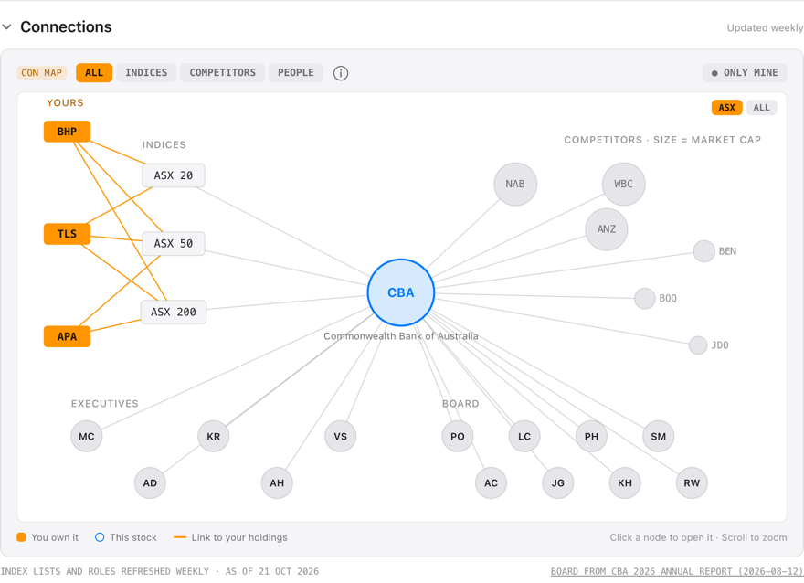
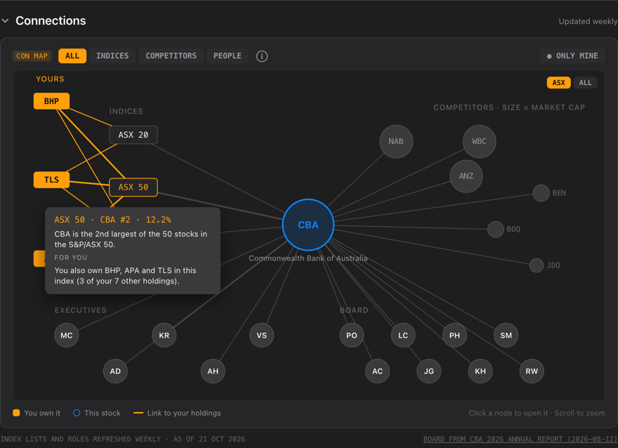
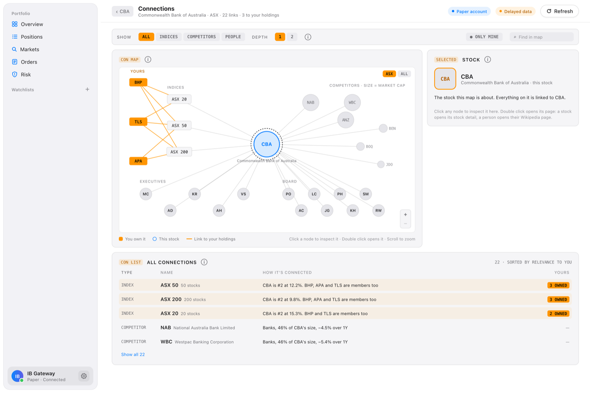
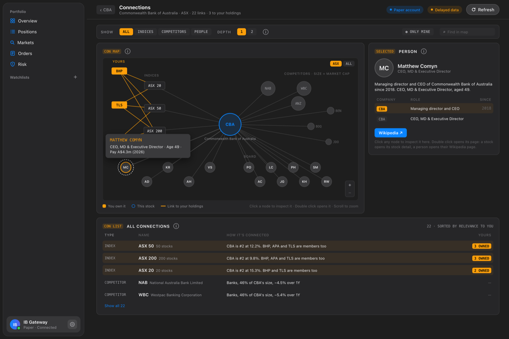

# IBKR Portfolio Manager

A cleaner, more intuitive portfolio dashboard for Interactive Brokers, with AI summaries of your stocks and your whole portfolio.

Interactive Brokers is a powerful broker, but its native interface is dense and hard to navigate. This project connects directly to IBKR through IB Gateway and presents your portfolio in a simpler, modern interface, in the browser or as a Mac app.

> **Status:** Dashboard, stock detail, Markets search, watchlists, trading and AI summaries (per stock and for the whole portfolio) work, in the browser and as a Mac app for Apple Silicon (version 0.2.1).

## Screenshots

| | Light | Dark |
|---|---|---|
| **Overview** |  |  |
| **Positions** |  |  |

**Stock detail** (Positions screen, scrolled):

| Light | Dark |
|---|---|
|  |  |

**Connections** (on the stock detail, CBA; hovering an index):

| Light | Dark |
|---|---|
|  |  |

**Connections full page** (CBA, Matthew Comyn selected):

| Light | Dark |
|---|---|
|  |  |

*Paper trading account; prices delayed about 15 minutes. These screenshots predate Markets, watchlists, trading and the AI summaries.*

## Features

### Working now
* Overview: net liquidation value, cash, buying power and total unrealised P&L
* Sortable positions table (money columns compared in AUD, so US and ASX holdings sort correctly)
* Allocation card that switches between market value, cost basis, quantity and unrealised P&L
* Positions screen: searchable holdings list with an All / ASX / US filter and a resizable sidebar
* Price chart per holding (1D to All) with your average cost marked and the return for the selected range
* Stock detail sections you can expand or collapse (remembered): key statistics, company profile, news, and total return vs the ASX 200 or S&P 500 over YTD, 1, 3 and 5 years
* System, light, dark or Terminal (near-black) appearance
* Adjustable text size (Small to Larger, also ⌘+ / ⌘− / ⌘0 in the Mac app) and trackpad pinch to zoom
* Refreshes every 60 seconds, and recovers on its own if IB Gateway disconnects and comes back

* AI stock summary (Claude): a 10-part briefing on any holding, covering the business, financial health, valuation, a news digest, why the price moved, upcoming events, bull and bear case, key risks, what it means for your position, and why the price moved since your last summary (in line with the market given the stock's beta, or company specific, with any news from that window). It only uses data the app fetched, cites a source for every point, and never gives buy/sell advice
* AI portfolio summary on Overview: the same kind of briefing for the whole portfolio (value, allocation, what drove the P&L, concentration, upcoming events, dividends, key risks, changes since last time), with its own history and compare; a cited holding opens on Positions
* Summary history: reopen any of the last 20 summaries of a stock, or compare two side by side, with the exact changes in the data (price, P/E, analyst target, dividend yield, P&L, new news) and each point tagged as new, changed or no longer present

* Markets: search any ASX or US stock by symbol or name, see its price, chart, statistics, news and an AI summary (without the Your position part), with recently viewed stocks
* Watchlists: as many as you like in the sidebar, each with price and day change for any ASX or US stock; add stocks from the watchlist's search field, the Watch button on any stock, or by dragging a row onto a watchlist in the sidebar (stored on your computer only)
* News sentiment: green or red arrows (1 to 3) on each headline, showing how good or bad it is for that company, judged by Claude once per article
* Trading (paper or live account, in the browser and the Mac app): an order ticket with IBKR's own cost and commission estimates, a review step, live order status, and an Orders page to change or cancel open orders, and orders that would borrow from IBKR blocked by default. See [Trading safety](#trading-safety)
* Purchase dates and 12-month CGT discount dates per lot from an IBKR Flex Query ([setup](docs/flex-query.md)), shown in Your position and used in the AI summary (browser version; the Mac app can't take a Flex token yet)
* Mac app that sets up and runs IB Gateway itself, with your IBKR password never stored
* Risk page: 3M / 1Y / 3Y periods, ten headline figures (volatility, betas, effective holdings, max drawdown, Sharpe ratio, tracking error, Value at Risk, liquidity) and twelve panels (concentration, exposure, correlation heatmap, volatility and beta, currency effect, hidden factors, stress tests, Value at Risk, attribution vs your home market's index, example mixes and hedges, bankruptcy risk, liquidity), each with an ⓘ that explains the number in plain words using your own figures; worked out from daily closes in your account's currency (Australian dollars and the ASX 200 for an AUD account, Singapore dollars and the STI for SGD), with every formula explained in [docs/risk-maths.md](docs/risk-maths.md). It describes, never advises
* The AI portfolio summary's key risks can cite the Risk page's findings
* Connections on every stock's detail (Positions, Markets, watchlists): a relationship map with the stock in the middle, the indexes it's in (S&P 500, Nasdaq 100, Dow, ASX 20 / 50 / 200, with its rank and weight) and your holdings in them, the largest companies in its industry sized by market cap (its own market, or both), its executives and its board. Anything linked to what you own is amber, including a director who sits on the board of one of your holdings. Hover for details, click to open a stock, scroll to zoom. **Open full map** opens a full page: the same map with depth 1 or 2 (depth 2 adds the other boards each director sits on), an inspector for the selected node (for a person, their roles at other companies and a Wikipedia link when known), find in map, and a list of every connection, the ones touching your holdings first. Index members and market data are refreshed in the background (Yahoo, no API key; a bundled copy means it only tops up), on by default: `INDEX_LOADER=0` in `.env`, or `"load_index_members": false` in the app's `settings.json`, turns it off
* Boards of directors (in Connections): each director's role, independence, year joined, age, committees and other company boards, read by Claude (Haiku 5.5) from the company's own document and linked to the page it came from. US boards come from SEC proxy statements; the S&P 500's ship with the app. ASX boards come from the company's annual report on the ASX, which ASX allows for personal use only, so they are read in your own app when you ask (a few US cents on your API key) after you accept ASX's terms. Each name and quote is checked against the document. People are linked across companies ("also on BHP's board") only by Wikidata ID or when one document names the other company; a shared name alone is shown as a possible match. A newer proxy or annual report is spotted weekly
* Supply chain pipeline (Settings > Supply chain pipeline, off by default): reads the SEC filings of an AI hardware watch list in the background and the customer figures companies tag in them, with a switch, a monthly budget in US dollars (it pauses itself when used up; it uses your own Anthropic key when it reads reports with Claude) and a status sheet: coverage, links found, what needs attention, cost, the companies with their filings, and a live log. The supplier map itself comes in a later version
* Competitors (backend, no UI yet): for any ASX or US stock, the index companies in the same industry from both markets, largest first, with market cap, 1-year change, P/E and whether you own them; widens to related industries or the sector when there are fewer than 4

### Planned
* Flex purchase dates in the Mac app's Settings (needs a design, #89), and entering purchase dates by hand
* Usage and cost of the AI features shown in the app (the backend already tracks it: `GET /usage`)

## Roadmap

* [x] **Milestone 1:** Connect to IB Gateway (paper trading account)
* [x] **Milestone 2:** Backend REST API exposing account and position data
* [x] **Milestone 3:** Minimal React UI
* [x] **Milestone 4:** Polished UI
* [x] **Milestone 4.5:** Expanded stock detail (key statistics, company profile, news, performance via yfinance)
* [x] **Milestone 5:** AI stock summaries via the Claude API, with summary history and compare, and explanations of price moves since the last summary
* [ ] **Milestone 5.1:** Purchase dates per lot from an IBKR Flex Query, each with its 12-month CGT date: done in Your position and the AI summary; the Mac app's Settings rows and manual entry are still to do
* [x] **Milestone 5.2: AI portfolio summary** on the Overview page: 8 sections, citations to the facts and holdings, history and compare
* [ ] **Milestone 6: Trade placement:** built; the end-to-end paper test run ([checklist](docs/paper-trading-test.md)) is still to do
* [x] **Milestone 7: Desktop app and sharing:** Mac app (Tauri) with a bundled backend, Gateway setup and sign-in, IBKR password never stored, optional encrypted API key, DMG
* [x] **Milestone 8: Risk analysis:** a Risk page with 10 headline figures and 12 panels (concentration, exposure, correlation, volatility and beta, currency effect, hidden factors, stress tests, Value at Risk, attribution, example mixes, bankruptcy risk, liquidity), each explained in plain words with your own numbers, and the main findings in the AI portfolio summary ([the maths](docs/risk-maths.md))
* [ ] **Milestone 9: Company connections:** index members, the indexes a stock belongs to, competitors, executives, boards of directors and the Connections section on the stock detail are done; the full map page is next
* [x] **Milestone 10:** Supply chain graph foundation: the schema with the evidence behind every link, a job queue, the SEC client and scout, an AI hardware watch list, company name matching, the major customer figures tagged in 10-Ks, and a pipeline status sheet in Settings ([docs/supply-chain-graph.md](docs/supply-chain-graph.md)). The supplier map itself is Milestones 11 to 13
* [ ] **Milestone 11:** Extraction agents
* [ ] **Milestone 12:** Supply chain explorer
* [ ] **Milestone 13:** Analyst agent and shared graph

## Tech Stack

| Layer | Technology |
|---|---|
| Broker connection | Interactive Brokers IB Gateway |
| Backend | Python 3.11, [FastAPI](https://fastapi.tiangolo.com/), [ib_async](https://github.com/ib-api-reloaded/ib_async) (the maintained successor to ib_insync) |
| Extra market data | [yfinance](https://github.com/ranaroussi/yfinance) (Yahoo Finance) for company info, fundamentals, news and long-term performance |
| Frontend | [React](https://react.dev/) with [Vite](https://vite.dev/), plain CSS, hand-drawn SVG charts |
| AI | Claude API (Claude Haiku 4.5 by default; Haiku 5.5 and Sonnet 5.5 selectable) for stock and portfolio summaries and news sentiment |
| Mac app | [Tauri 2](https://tauri.app/) (Rust) wrapping the React frontend; the backend bundled with PyInstaller |
| Tests | Python `unittest` (backend), [Vitest](https://vitest.dev/) (frontend), `cargo test` (Mac app shell) |

## Architecture

```
React frontend  <-->  Python REST API  <-->  IB Gateway (localhost)  <-->  Interactive Brokers
                        |          |
                        v          v
                   Claude API   Yahoo Finance
```

The React frontend talks only to the Python backend. The backend manages the connection to IB Gateway running locally (account, prices, orders), fills in company data, news and long-term performance from Yahoo Finance, and calls the Claude API for the AI summaries and news sentiment.

For the full picture (the Mac app's parts, every backend module and page, and step by step diagrams of sign in, AI summaries, orders and updates), see **[docs/architecture.md](docs/architecture.md)**.

## Install the Mac app

For a Mac with Apple Silicon (M1 or later) and macOS 13 or later. You won't need the terminal or to open IB Gateway yourself.

1. Open the `Portfolio Manager` DMG you were sent and drag **Portfolio Manager** into **Applications**.
2. Open it from Applications. The first time, macOS stops it, because the app isn't from the App Store and isn't signed by a registered developer. Click **Done**.
3. Open **System Settings → Privacy & Security** and scroll down to **Security**. Next to "Portfolio Manager was blocked to protect your Mac", click **Open Anyway**, enter your Mac password, then click **Open Anyway** again. You only do this once.
4. In the app, click **Get Started**, then **Download IB Gateway**. When IBKR's installer opens, click Continue through it and keep the suggested folder, then click **Continue** in the app.
5. Sign in with your IBKR username and password and choose **Live** or **Paper**. With a live account, approve the login in IBKR Mobile on your phone.
6. Optional: to turn on AI summaries, open Settings (click your account at the bottom of the sidebar, then **Settings…**, or press **⌘,**) and paste an Anthropic API key under **AI summaries**.

The app never saves your IBKR password: you type it each time you open the app. The API key is kept in memory only, unless you switch on **Remember key on this Mac** in Settings. Then it is saved encrypted (ChaCha20-Poly1305) in the app's data folder, with the encryption key in a separate file; both are readable only by you, and macOS never asks for a password. Because the encryption key is on the same Mac, malware running as you could still recover the API key, so set a monthly spend limit on the key in the Anthropic console. The key can only spend Anthropic credit; it has no access to your broker account. **Remove** or turning the switch off deletes both files.

### Using a second IBKR username

Each IBKR username can be signed in in only one place at a time. If the app uses the same username as IBKR Mobile, TWS or the website, signing in to the app signs you out there, and the other way round. A second username for the same account avoids that.

- **Live accounts:** in IBKR's Client Portal, go to **Settings → Users & Access Rights** and add a user, then sign in to the app with that username. Market data subscriptions belong to a username, so the new one starts with free delayed prices, which is what this app uses anyway.
- **Paper accounts** already have their own username, separate from your live one, so you don't need a second one.

### Updates

When a new version is published, the app offers it at launch: a small window with the version number, what changed, and **Update Now** or **Later**. You can also choose **Portfolio Manager → Check for Updates…** at any time. Update Now downloads the new version, signs you out of IBKR, installs it and restarts the app. If macOS doesn't let the app replace itself, it offers the release page instead, where you can download the DMG and install it by hand.

## Releasing a new version

Releases are built by GitHub Actions (`.github/workflows/release.yml`) when a version tag is pushed, and land as a **draft**: nobody gets the update until you publish it.

### One-time setup: the update signing key

The app only installs updates signed with your key, so keep it safe; if it's lost, everyone has to reinstall from a DMG once.

1. Generate the key (choose a password when asked):
   ```bash
   cd frontend
   npx tauri signer generate -w ~/.tauri/portfolio-manager-updater.key
   ```
   This creates `~/.tauri/portfolio-manager-updater.key` (private, **never commit it**; `*.key` is gitignored) and `~/.tauri/portfolio-manager-updater.key.pub` (public).
2. Back up the private key file and its password in your password manager.
3. Put the public key in the app: copy the contents of the `.pub` file into `frontend/src-tauri/tauri.conf.json` as `plugins.updater.pubkey` (replacing `REPLACE_WITH_UPDATER_PUBLIC_KEY`), and commit that.
4. Add two repository secrets on GitHub (**Settings → Secrets and variables → Actions → New repository secret**):
   - `TAURI_SIGNING_PRIVATE_KEY`: the full contents of `~/.tauri/portfolio-manager-updater.key`
   - `TAURI_SIGNING_PRIVATE_KEY_PASSWORD`: its password

### Each release

The version lives in one place, `frontend/package.json` (the app reads it from there).

```bash
# 1. Bump "version" in frontend/package.json (e.g. 0.2.2), then:
git commit -am "chore: release 0.2.2"
# 2. Tag it with a message; the message becomes the release notes shown in the app
git tag -a v0.2.2 -m "AI portfolio summary on Overview. Links open in your browser."
git push origin main v0.2.2
```

The workflow stops with a clear error if the tag has no message (a plain `git tag v0.2.2`), if it doesn't match the version in `package.json`, or if the public key is missing. When it finishes, open **Releases** on GitHub, check the draft (the DMG, the `.app.tar.gz` update with its `.sig`, and `latest.json`), and click **Publish release**. Apps check `releases/latest/download/latest.json`, so they see it from that moment.

The first version with updates (0.2.0) has to be installed from its DMG; after that, updates arrive in the app.

## Getting Started

### Prerequisites

* An Interactive Brokers account with a **paper trading** account enabled (created via the IBKR Client Portal)
* [IB Gateway](https://www.interactivebrokers.com/en/trading/ibgateway-stable.php) installed, with API access enabled on port 4002
* Python 3.11
* Node.js 20.19+ or 22.12+ (for the frontend)
* For the Mac app only: [Rust](https://rustup.rs/) (`rustup`)

### Setup

```bash
git clone https://github.com/Indomie-glitch/ibkr-portfolio-manager.git
cd ibkr-portfolio-manager

# Backend
cd backend
python3.11 -m venv venv
source venv/bin/activate
pip install -r requirements.txt
# To build the Mac app as well: pip install -r requirements-build.txt
cd ..

# Frontend
cd frontend
npm install
```

### Configuration

Copy the example environment file and fill in your values:

```bash
cp .env.example .env
```

| Variable | Description |
|---|---|
| `SEC_CONTACT_EMAIL` | Needed for US boards of directors: SEC requires a contact email in every EDGAR request. The Mac app's build bundles it (`backend/write_app_config.py`; CI reads the `SEC_CONTACT_EMAIL` repository secret), so anyone with the app can read it |
| `PIPELINE`, `PIPELINE_WORKERS` | Optional: `1` starts the supply chain pipeline's background workers with the app (off by default: they download filings and spend AI budget); the number of workers (default 2) |
| `OPENFIGI_API_KEY` | Optional: a free OpenFIGI key for the supply chain pipeline's company name matching; without one OpenFIGI allows 25 searches a minute, with one 250 |
| `INDEX_LOADER` | Optional: `0` turns off the background refresh of index members and their market data (on by default; the endpoints still answer from whatever is stored) |
| `ANTHROPIC_API_KEY` | Your Claude API key (needed for AI summaries; only used by the backend) |
| `AI_MODEL` | Claude model for summaries, `claude-haiku-4-5` by default |
| `IB_HOST` | IB Gateway host, usually `127.0.0.1` |
| `IB_PORT` | IB Gateway port (`4002` for paper trading, `4001` for live) |
| `IB_CLIENT_ID` | API client ID, `1` by default; use a different one if another app is already connected with it |
| `MAX_ORDER_VALUE` | The largest order allowed, in the account's base currency (default 10000) |
| `IB_FLEX_TOKEN`, `IB_FLEX_QUERY_ID` | Optional: IBKR Flex Web Service token and query ID, for purchase dates and the 12-month CGT date ([setup guide](docs/flex-query.md)); the token is a secret |

### Run

Start IB Gateway and log in to your paper account. Then, in two terminals:

```bash
# Terminal 1: API on http://localhost:8000
cd backend
source venv/bin/activate
uvicorn main:app --reload
```

```bash
# Terminal 2: app on http://localhost:5173
cd frontend
npm run dev
```

Open http://localhost:5173. The backend starts even if IB Gateway isn't running yet, and connects as soon as it is.

#### As a Mac app (development)

With the backend running as above, open the frontend in a native window instead of the browser:

```bash
cd frontend
npm run tauri dev      # window with hot reload, using the backend you started yourself
npm run build:app      # packages the backend (PyInstaller) and builds
                       # src-tauri/target/release/bundle/macos/Portfolio Manager.app
npm run build:dmg      # the same, plus an unsigned Apple Silicon DMG to send:
                       # src-tauri/target/release/bundle/dmg/Portfolio Manager_<version>_aarch64.dmg
```

The app is ad-hoc signed (no Apple Developer ID), so on another Mac it opens only after
**Open Anyway** (see [Install the Mac app](#install-the-mac-app)); it isn't notarised.

The built app starts its own copy of the backend on a free port, with a random access token for that
launch (so other programs on the Mac can't use its API), and stops it when it quits. Its data lives in
`~/Library/Application Support/com.indomieglitch.portfoliomanager/` and the backend's log in
`~/Library/Logs/com.indomieglitch.portfoliomanager/backend.log`. It sets up and signs in to IB Gateway itself
(see Milestone 7); you never open Gateway directly.

### Tests

```bash
# Backend (Claude is faked; no API calls, no IB Gateway needed)
cd backend && venv/bin/python -m unittest discover tests

# Frontend: unit tests, lint, production build
cd frontend && npm test && npm run lint && npm run build

# Mac app shell
cd frontend/src-tauri && cargo test
```

### API

| Endpoint | Returns |
|---|---|
| **Connection and account** | |
| `GET /health` | Whether the backend is connected to IB Gateway (and if not, why), and whether IBKR still answers while connected (it stops when the account logs in somewhere else) |
| `GET /account` | Net liquidation, cash, positions value, buying power, unrealised P&L, FX rates (IB's ledger, plus IB forex or Yahoo for currencies the account holds no cash in), cash per currency and any negative balances (money owed to IBKR) |
| `GET /positions` | Each holding with price, market value, unrealised P&L and company name |
| `GET /quotes` | Last price and day change per holding (delayed) |
| `GET /history/{con_id}?range=1M` | Price history for the chart (`1D`, `1W`, `1M`, `3M`, `1Y`, `All`) |
| **Markets** | |
| `GET /search?q=` | ASX and US stocks matching a symbol or company name (IB symbol search, cached 10 min), marked if owned |
| `GET /prices?con_ids=` | Quotes for any stocks, same shape as `/quotes` (for search results) |
| **Stock detail (Yahoo Finance)** | |
| `GET /profile/{con_id}` | Company profile from Yahoo Finance (cached 1 hour) |
| `GET /stats/{con_id}` | Market cap, P/E, EPS, beta, dividends, 52-week range, analyst target (Yahoo, cached 1 hour) |
| `GET /news/{con_id}` | Recent headlines that name the company (Yahoo, cached 15 minutes), each with its sentiment for the company (positive / negative / neutral, strength 1-3; Claude, judged once per article) when an API key is set |
| `GET /executives/{con_id}` | The company's executives from Yahoo: name, title, age and pay when listed (pay in the company's reporting currency), and whether each also sits on the board; board-only members are listed apart under `directors`. Cached 1 week. No start year, Wikipedia or Wikidata link yet (Yahoo has none; those fields are empty) |
| `GET /performance/{con_id}` | Total return YTD, 1Y, 3Y, 5Y vs a total return index (Yahoo, cached 1 day) |
| **Purchase dates (Flex)** | |
| `GET /lots/status` | Whether Flex purchase dates are set up, when they were last fetched, and the last error |
| `GET /lots/{con_id}` | A holding's purchase lots with their 12-month CGT discount dates (from the Flex report) |
| **AI stock summary** | |
| `GET /summary/{con_id}` | The last saved AI summary for a stock (a holding, or any stock from Markets) |
| `POST /summary/{con_id}` | Writes a new AI summary, streamed section by section (Server-Sent Events); a stock you don't own gets 9 sections, without Your position |
| `GET /summary/{con_id}/facts` | The exact data the AI summary is based on (no API call) |
| `GET /summary/{con_id}/history` | Saved summaries of a holding, newest first (id, time, model, price at the time) |
| `GET /summary/{con_id}/history/{summary_id}` | One saved summary in full |
| `GET /summary/{con_id}/compare?a=&b=` | Two saved summaries (older first) and the exact changes between their data |
| **AI portfolio summary** | |
| `GET /portfolio-summary` | The last saved AI portfolio summary, and whether AI is set up |
| `POST /portfolio-summary` | Writes a new AI portfolio summary (8 sections), streamed like the stock summary |
| `GET /portfolio-summary/facts` | The data the AI portfolio summary will be based on: weights, allocation, P&L contributors, concentration, events, dividends (no API call) |
| `GET /portfolio-summary/history` | Saved portfolio summaries, newest first (id, time, model, net liquidation) |
| `GET /portfolio-summary/history/{summary_id}` | One saved portfolio summary in full |
| `GET /portfolio-summary/compare?a=&b=` | Two saved portfolio summaries (older first) and the exact changes between their data |
| **Index members** | |
| `GET /indices` | Each index (S&P 500, Nasdaq 100, Dow, ASX 20 / 50 / 200): member count, the holdings file's date, when it was fetched, and whether the last download failed (an older copy is shown) |
| `GET /indices/{con_id}` | The indexes a stock belongs to, with its weight and rank in each |
| `GET /indices/{index}/members` | One index's members, largest weight first: name, weight, rank, sector, industry, market cap, P/E, 1-year change |
| `GET /directors/{con_id}` | The company's board as read from its latest proxy statement (US) or annual report (ASX): each director's role, independence, year joined, age, committees, other boards, the page and a quote, a link to that page, Wikidata / Wikipedia when known, other boards they sit on among the companies read (`also_on`) and same-name `possible_matches`. `status` `not_read` with `needs` (API key, SEC contact email, ASX terms) when it hasn't been read; `newer_document` when a newer one has been filed |
| `POST /directors/{con_id}` | Reads (or re-reads) the board now with Claude Haiku 5.5 on your API key (about US$0.005; 10 to 60 seconds) |
| `GET /directors/asx-terms`, `POST /directors/asx-terms` | Whether you've accepted ASX's terms (company announcements for private and personal use), and accepting or withdrawing that; ASX boards can't be read without it |
| `GET /people/{person_id}` | Every board seat one person holds among the boards read so far |
| `GET /pipeline` | The supply chain pipeline's status (off, running, paused, budget used up), workers, coverage, links, what needs attention, cost against the monthly budget, and its switches |
| `GET /pipeline/companies`, `GET /pipeline/companies/{company_id}/filings` | The watched companies with latest filing, when it was read, links, 7 day change, status and cost; one company's filings and where each stands |
| `GET /pipeline/log?kind=all\|links\|failed` | The live log: RUN, LINK, DONE, FAIL, SCOUT lines, newest first |
| `POST /pipeline/settings`, `POST /pipeline/run-now`, `POST /pipeline/retry` | Switch it on or off, pause it, set the monthly budget; look at every watched company now; retry failed items |
| `GET /competitors/{con_id}` | Companies in the stock's industry among the index members (ASX and US), largest market cap first, with market, market cap, 1-year change, P/E and whether you own each; the stock itself is marked. Says which level was used (industry, related industries or sector) and whether sectors are still loading. `?scope=same_market` ranks only among companies on the stock's own market |
| **AI usage** | |
| `GET /usage?month=YYYY-MM` | Tokens and estimated cost (US$) of every Claude call in a month (default this month), in total and per feature (stock summaries, portfolio summaries, news sentiment) |
| **Risk analysis** | |
| `GET /risk?period=1Y` | Risk figures for the stock holdings over `3M`, `1Y` or `3Y`, from daily closes in the account's base currency (Yahoo, with each foreign currency's daily rates, stored locally; [the maths](docs/risk-maths.md)): which holdings and days were used, which were left out and why, each holding's share of money vs share of risk with effective holdings and warnings, the split by currency, market and sector, how much of foreign holdings' return came from the exchange rate, how each pair of holdings moves together (correlation), volatility, beta and the biggest fall, the hidden factors behind how the holdings move, the Sharpe ratio and tracking error, Value at Risk (formula, history and simulation), and stress tests (2008, 2020 and 2022 replayed on today's holdings, and simple shocks), why the holdings beat or trailed the home market index (ASX 200 for AUD accounts, STI for SGD, otherwise the S&P 500; allocation, selection, currency), example mixes of the same stocks with two hedges (examples, not advice), each company's Altman Z score, and how long each holding would take to sell; each later section is added to this answer |
| `GET /risk/bankruptcy` | Each holding's Altman Z score (financial distress) from its latest annual accounts (Yahoo, cached a day); separate so a Yahoo failure only affects that panel |
| **Trading** | |
| `GET /trading/status` | Paper or live account, whether orders are allowed (and why not), and the order limit |
| `POST /orders/preview` | What an order would cost (IB what-if: commission, margin change) and any guardrail problems, without sending it; `borrow` says how much a buy would borrow from IBKR (blocked unless Block borrowing is off); returns a `confirmation_token` when it can be placed |
| `GET /trading/borrowing` | Whether orders that would borrow are blocked for the connected IBKR account (on by default) |
| `POST /trading/borrowing` | Browser version only: turn blocking back on, or off with `"confirm": "BORROW"` (the Mac app uses Touch ID instead) |
| `POST /orders` | Places a previewed order: needs the preview's single-use `confirmation_token` (2 minutes, exactly that order); every check runs again first |
| `POST /orders/{order_id}/cancel` | Cancels an open order |
| `POST /orders/{order_id}/modify` | Changes an open order's quantity, limit price, order type or time in force (Day / GTC); needs a `confirmation_token` from a preview of the changed order. If IBKR can't make the change in place (e.g. market to limit), the order is cancelled and placed again, and the response's `replaced` says so |
| `GET /orders` | Open orders (from every client), and today's filled and cancelled orders, for the Orders page |
| `GET /orders/stream` | Server-Sent Events: every known order at the start (`orders`), then each status change or fill (`order`) |

**Note on market data:** if your live IBKR account is logged in somewhere else (TWS, the mobile app or the web portal), IB blocks quotes on the paper account (error 10197). The app then works out day change from IB's daily price history instead.

**Note on AI costs:** with Claude Haiku 4.5, a stock or portfolio summary costs roughly US$0.01 to US$0.02, and news sentiment about US$0.002 per stock (each headline is judged once). Every call's tokens and estimated cost are logged locally (`GET /usage`). Summaries are saved locally in `data/` (not committed); the last 20 per stock and 20 portfolio summaries are kept. Purchase dates (for the 12-month CGT discount) need an IBKR Flex Query; without one they show as unknown.

**Note on Yahoo Finance:** yfinance is an unofficial library and Yahoo can change or block it. If it fails, only the sections that use it show "unavailable"; the rest of the app keeps working. News comes from Yahoo's search, because yfinance's per-stock news call currently returns 404.

## Trading safety

Trading is **on** whenever the app is connected to IB Gateway, for a **paper or live** account,
in both the browser version and the Mac app. Orders on a live account use real money.

* **Know which account you're on.** The toolbar always shows a badge: **Paper account** (blue) or
  **Live account** (red). IBKR paper account IDs start with D.
* **Review before sending.** Every order is previewed with IBKR's what-if check first (cost,
  commission, margin), then shown on a confirmation sheet. Placing it needs a single-use
  confirmation token from that preview, valid for 2 minutes and only for exactly that order, so a
  changed number or a double click can't send something you didn't review.
* **Limits checked on the server.** Each order is checked again right before it's sent: whole
  shares only, no selling more than you hold (no short selling), and a maximum order value in your
  base currency (default 10,000; in the browser version set `MAX_ORDER_VALUE` in `.env`, while the
  Mac app always uses the default).
* **No borrowing by default.** IBKR accounts are margin accounts, so IBKR quietly lends money
  instead of rejecting an order that costs more than your cash. The app checks each buy against
  your cash **in the stock's own currency** (with an allowance for fees) and blocks it if it would
  borrow, saying how much and what to do. Buying a US stock with no US dollars counts: IBKR doesn't
  convert your AUD or SGD, it lends you the dollars. **Block borrowing** in Settings is on by
  default and saved per IBKR account; turning it off explains the risks first and needs Touch ID or
  your Mac password (typing BORROW in the browser version). With it off, orders that borrow still
  show the amount before you place them. Overview warns if any currency's cash is already below
  zero. Sells are never blocked. Open buy orders (from this app, TWS or the phone) are counted: what they
  will use when they fill is taken off the cash first, so two buys that each fit your cash but
  together would borrow are blocked.
* **Regular trading hours only.** Orders never trade before the open or after the close.
* **You choose how long an order lasts.** **Day** orders end at today's close if they haven't
  filled. **Good till cancelled** orders stay open on later days until they fill or you cancel them,
  so check the Orders page for any that are still open.
* **Ordering by amount rounds down.** When you enter an amount of money instead of a number of
  shares, the ticket works out the whole number of shares it buys (rounded down) and the review
  sheet shows that number before anything is sent.
* **Changing an order is reviewed too.** Modify can change the quantity, limit price, order type
  and time in force (not Buy or Sell), with a fresh preview and confirmation. If IBKR won't change
  an order in place (for example market to limit), the app cancels it and places a new one with the
  new details, and the result sheet says so; it won't do this once part of the order has filled.
* **Cancel is immediate.** Cancel on the Orders page sends the cancellation straight away, without
  a confirmation step.

Test every flow on a paper account with the [paper trading checklist](docs/paper-trading-test.md)
before using a live account.

## Project Structure

```
ibkr-portfolio-manager/
├── backend/          FastAPI app (main.py), IB Gateway connection, REST API
├── frontend/         React app (Vite)
│   └── src-tauri/    Mac app shell (Tauri, Rust)
├── docs/             Architecture diagrams, setup guides, specs and the supply chain graph design
│   └── screenshots/  Screenshots used in this README
├── scripts/          screenshots.mjs: retakes the README screenshots with headless Chrome
├── .env.example      Template for environment variables
└── README.md
```

## Disclaimer

This is a personal project and is not affiliated with Interactive Brokers. It can place real orders on a live account; test with a paper account first. Nothing in this project is financial advice, and you use it with real money at your own risk.