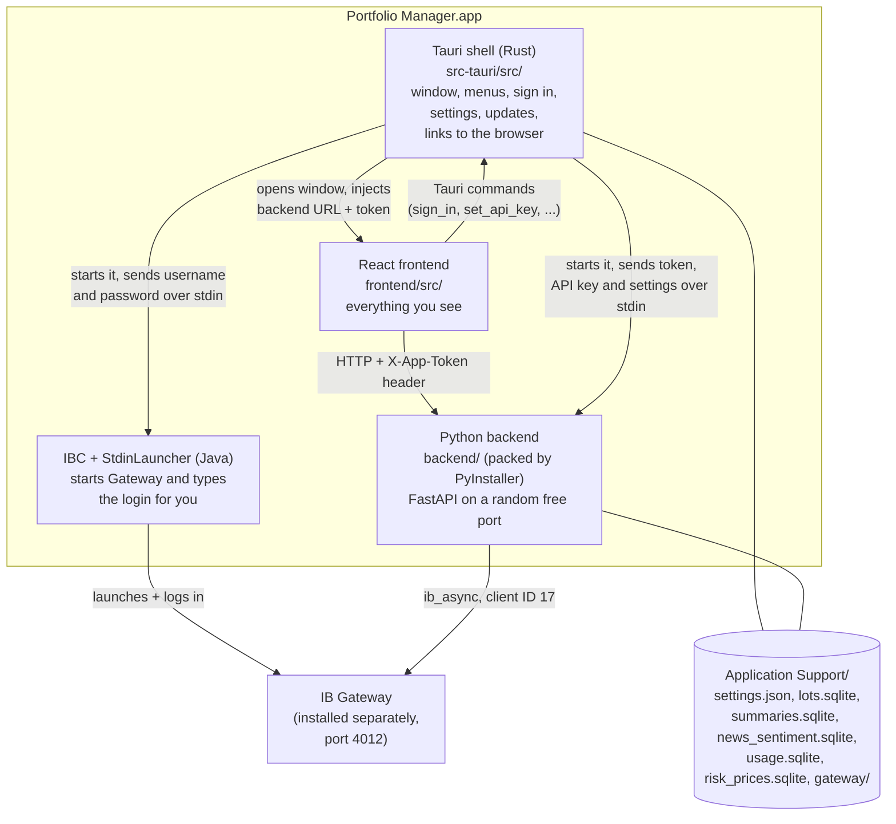
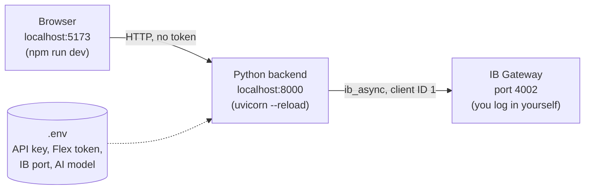
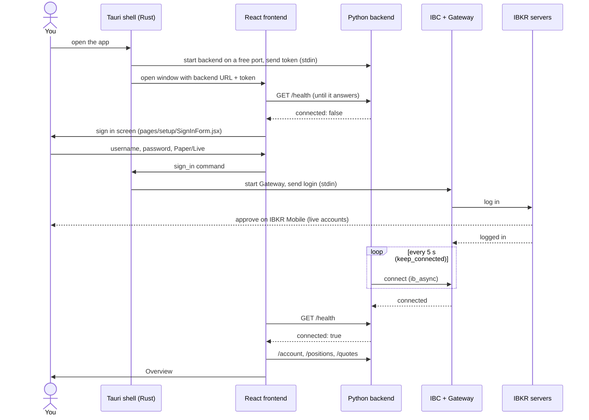
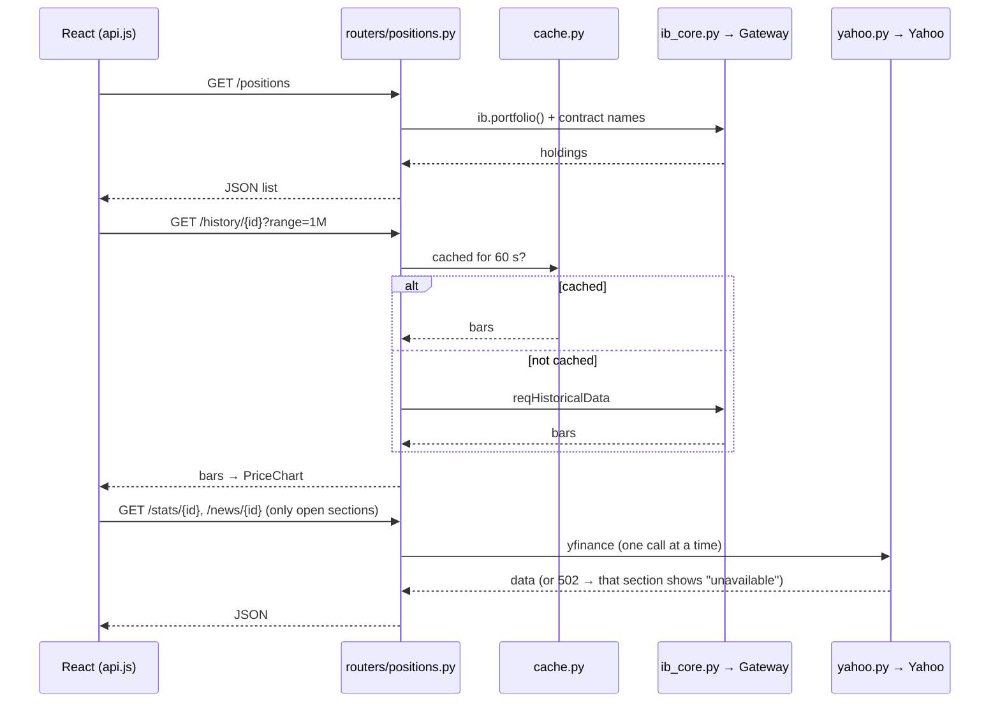
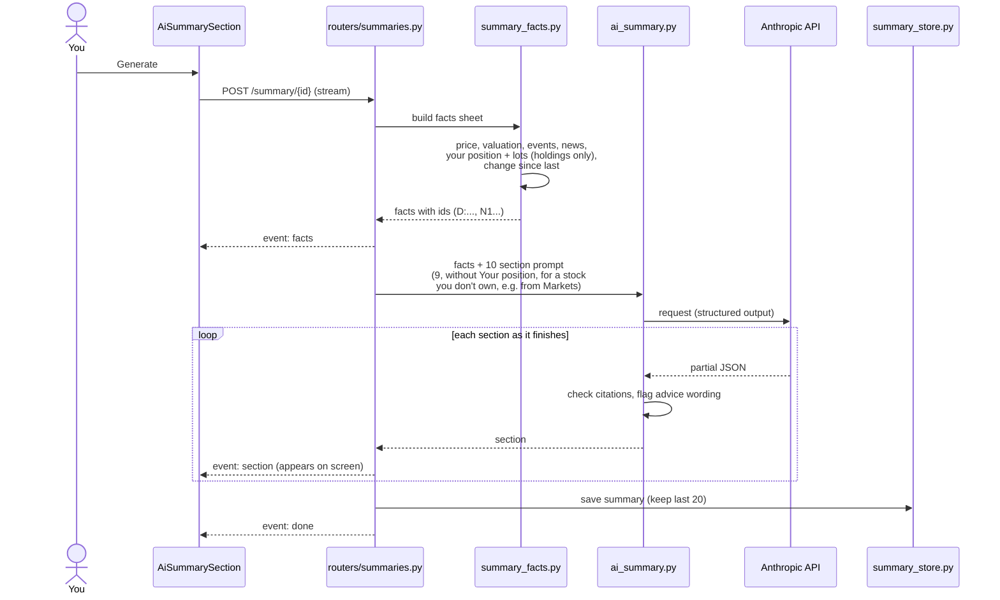
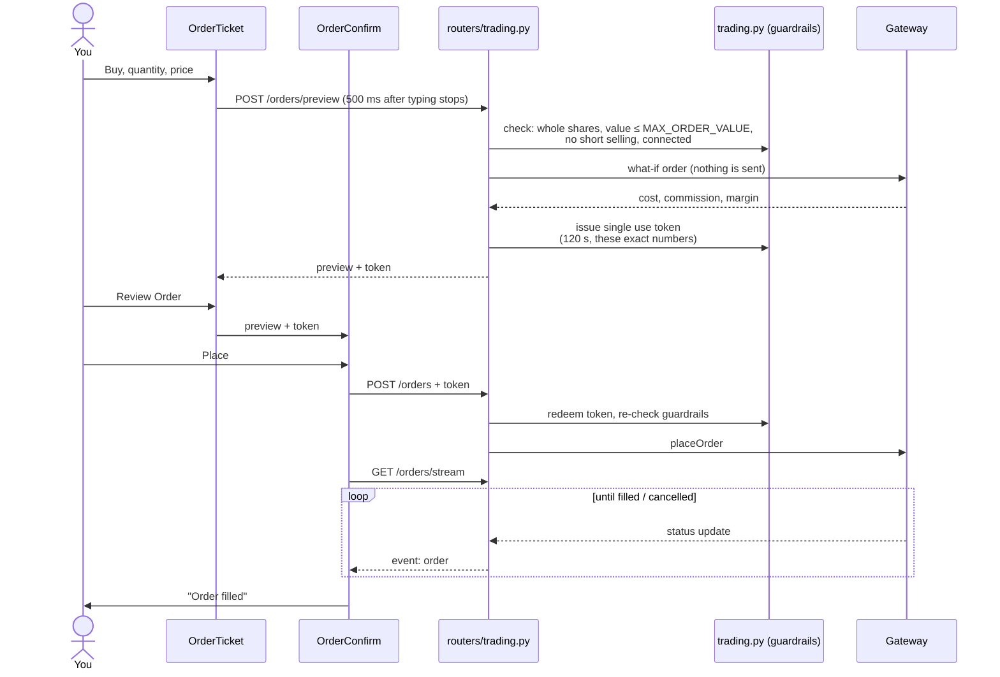
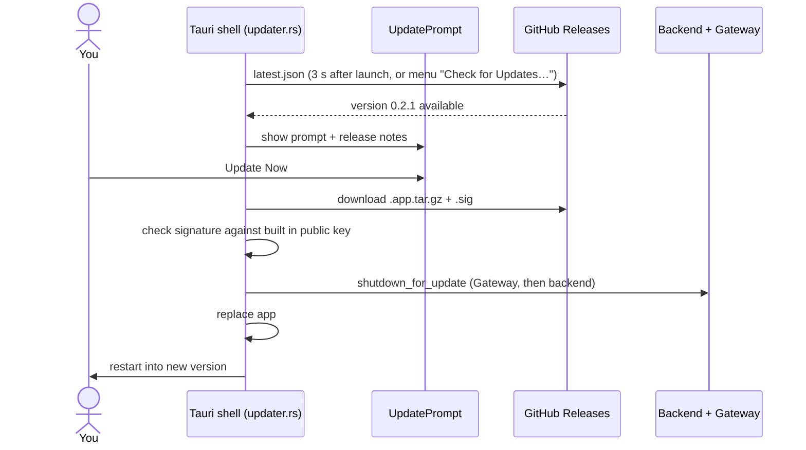
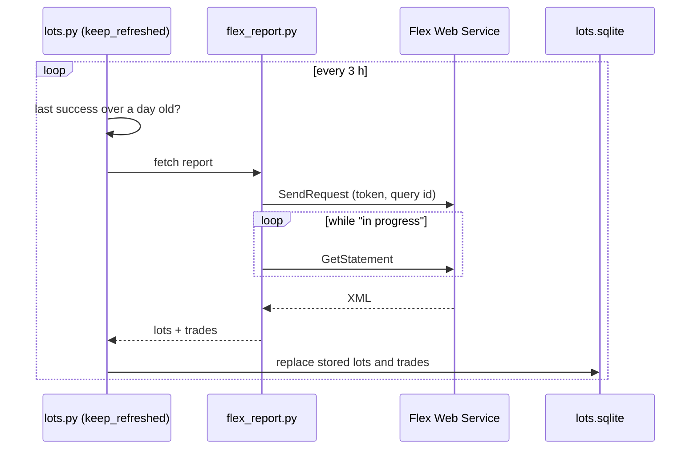

# Architecture

How the IBKR Portfolio Manager fits together, from the big picture down to single actions. Each diagram zooms in one level, like a map going from country to city to street.

1. [The big picture](#1-the-big-picture): the app and everything outside it
2. [Inside the app](#2-inside-the-app): the parts that run on your Mac
3. [Inside the backend](#3-inside-the-backend): Python modules
4. [Inside the frontend](#4-inside-the-frontend): React pages and components
5. [Key flows](#5-key-flows): step by step sequences for the main actions
6. [Where data lives](#6-where-data-lives)

GitHub draws these diagrams automatically. To edit one by hand in draw.io, use Arrange → Insert → Advanced → Mermaid and paste the diagram's code.

> Keep this file current: when a change adds, removes or renames a module, page, endpoint or external service, update the matching diagram in the same PR.

---

## 1. The big picture

Who uses the app, and which outside services it talks to.

```mermaid
flowchart LR
    user(["You<br/>(or a friend)"])

    subgraph mac["Your Mac"]
        app["Portfolio Manager<br/>(Mac app or browser dev version)"]
        gw["IB Gateway<br/>IBKR's own program,<br/>holds the broker login"]
    end

    ibkr[("IBKR servers<br/>accounts, prices, orders")]
    flex[("IBKR Flex Web Service<br/>purchase history report")]
    yahoo[("Yahoo Finance<br/>key stats, news,<br/>company info")]
    claude[("Anthropic API<br/>Claude writes the<br/>AI summaries and<br/>judges news sentiment")]
    gh[("GitHub Releases<br/>new app versions")]

    user -->|clicks, types| app
    app -->|"positions, quotes,<br/>orders (API on a local port)"| gw
    gw <-->|"encrypted session<br/>(username + password once)"| ibkr
    app -->|"daily report<br/>(Flex token)"| flex
    app -->|"public data<br/>(yfinance)"| yahoo
    app -->|"facts sheet or headlines in,<br/>summary or sentiment out (API key)"| claude
    app -->|"check for update,<br/>download signed update"| gh
```

**How to read it:** the app never talks to IBKR's servers directly. Everything to do with your account goes through IB Gateway, a program from IBKR that runs next to the app and keeps the logged in session. Yahoo fills in data IBKR doesn't provide, Claude only explains numbers the app has already calculated, and GitHub is only used for updates.

---

## 2. Inside the app

The separate programs running on your Mac, and how they connect. There are two ways to run it.

### Mac app (what friends install)



### Browser dev version (what you run while building)



**How to read it:** in the Mac app, the Rust shell is the boss. It starts the backend and Gateway, passes secrets to them through stdin (a private pipe between two programs, so the secrets are never written to a file), and kills both when you quit. The frontend only ever talks to the backend over HTTP, plus a few direct commands to the Rust shell for things like signing in. In the dev version you start each piece yourself, and settings come from `.env` instead.

**Why the token:** the backend listens on a local port, so other programs on your Mac could call it. The random per-launch token means only the app's own window is accepted.

---

## 3. Inside the backend

`main.py` only creates the app. Each file in `routers/` handles one area of the API (the URLs the frontend calls), and the modules below them do the real work.

```mermaid
flowchart TB
    main["main.py<br/>creates the app, starts<br/>background tasks"]

    subgraph routers["routers/ (the API)"]
        r_app["app.py<br/>/health"]
        r_pos["positions.py<br/>/positions /account /quotes<br/>/search /prices /history<br/>/profile /stats /news /performance"]
        r_flex["flex.py<br/>/lots/status /lots/{id}"]
        r_sum["summaries.py<br/>/summary/... /portfolio-summary/...<br/>/usage"]
        r_trade["trading.py<br/>/trading/status /orders<br/>/orders/preview /stream<br/>cancel, modify"]
        r_risk["risk.py<br/>/risk /risk/bankruptcy"]
    end

    subgraph core["Shared"]
        ib_core["ib_core.py<br/>IB connection, contract<br/>info, quotes, price bars"]
        ib_conn["ib_connection.py<br/>connect + reconnect,<br/>client ID clashes"]
        web["web.py<br/>Origin check, SSE streams"]
        cache["cache.py<br/>in-memory cache"]
        cfg["config.py<br/>.env + app settings"]
        guard["secrets_guard.py<br/>masks secrets in errors"]
        names["names.py<br/>tidy company names"]
        fx["fx.py<br/>exchange rates: ledger,<br/>IB forex, Yahoo;<br/>daily rate pairs"]
    end

    subgraph data["Data and AI"]
        yahoo["yahoo.py<br/>yfinance wrapper"]
        trading["trading.py<br/>guardrails, confirmation<br/>tokens, order summaries"]
        lots["lots.py<br/>purchase lots, CGT dates,<br/>daily refresh"]
        flex["flex_report.py<br/>download + parse Flex XML"]
        sfacts["summary_facts.py<br/>stock facts sheet<br/>(every number calculated here)"]
        pfacts["portfolio_facts.py<br/>portfolio facts sheet"]
        ai["ai_summary.py<br/>stock prompt, calls Claude,<br/>streams + checks sections"]
        pai["portfolio_summary.py<br/>portfolio prompt + checks"]
        store["summary_store.py<br/>saved summaries (SQLite)"]
        senti["news_sentiment.py<br/>news good/bad + strength,<br/>saved per article (SQLite)"]
        usage["usage_store.py<br/>tokens + cost of every<br/>Claude call (SQLite)"]
        rdata["risk_data.py<br/>daily closes (SQLite),<br/>base currency returns<br/>per window"]
        rmath["risk.py<br/>risk maths (numpy, pure)"]
        rsec["risk_sections.py<br/>one function per<br/>Risk page section"]
    end

    main --> routers
    main -->|"keep_connected task"| ib_core
    main -->|"keep_refreshed task"| lots
    ib_core --> ib_conn

    r_pos --> ib_core & yahoo & cache & names & senti & fx
    r_trade -.-> fx
    r_risk -.-> fx
    rdata -.->|rate pairs| fx
    fx --> ib_core & yahoo & cache
    r_flex --> lots & ib_core
    r_trade --> trading & ib_core & web
    r_sum --> sfacts & pfacts & ai & pai & store & lots & web & usage
    r_sum -.->|reuses| r_pos
    r_risk --> rdata & rsec & cache & ib_core
    rsec --> rmath
    r_risk -.->|reuses| r_pos
    r_sum -.->|D:risk| r_risk
    rdata --> yahoo & rmath

    lots --> flex
    sfacts --> yahoo
    pfacts --> sfacts
    pai --> ai

    ib_core -->|ib_async| GW[["IB Gateway"]]
    yahoo -->|yfinance| YF[["Yahoo Finance"]]
    flex -->|HTTPS| FX[["Flex Web Service"]]
    ai -->|anthropic SDK| AN[["Anthropic API"]]
    senti -->|anthropic SDK| AN
    senti --> usage
```



**How to read it:** arrows point from the file that uses something to the file it uses. The important rule in the AI part: `summary_facts.py` and `portfolio_facts.py` calculate every number, and Claude (via `ai_summary.py`) is only allowed to explain them and must cite which fact each point comes from. That is how the summaries avoid made up numbers.

**Background tasks** (started by `main.py` when the server starts):
* `keep_connected`: keeps trying to connect to IB Gateway every 5 seconds, so the backend starts fine even when Gateway isn't running and reconnects after drops.
* `keep_refreshed`: downloads the Flex purchase report once a day.

---

## 4. Inside the frontend

`App.jsx` holds the shared data (account, positions, quotes, connection state) and shows one page at a time.

```mermaid
flowchart TB
    main["main.jsx"] --> App["App.jsx<br/>loads account, positions, quotes,<br/>trading status; picks the page"]

    Sidebar --> SidebarWatchlists["SidebarWatchlists.jsx<br/>+ button, rows with counts,<br/>naming, Rename / Delete,<br/>drop stock rows here"]
    App --> Sidebar & Toolbar & SessionBanner & UpdatePrompt & ConnectionMessage
    App --> Setup["pages/setup/<br/>first run + sign in (Mac app):<br/>Setup.jsx flow, one file per screen"]
    App --> Overview["pages/Overview.jsx"]
    App --> Positions["pages/Positions.jsx"]
    App --> Markets["pages/Markets.jsx"]
    App --> Orders["pages/Orders.jsx"]
    App --> Watchlist["pages/Watchlist.jsx<br/>one watchlist: its stocks,<br/>add from search, empty state"]
    App --> Risk["pages/Risk.jsx<br/>command bar, headline tiles,<br/>12 panels, data notes"]
    Risk --> RiskTile["risk/RiskTile.jsx"] & RiskPanel["risk/RiskPanel.jsx<br/>frame: RSK tag, title, ⓘ;<br/>loads its own section"]
    RiskTile & RiskPanel --> InfoButton["risk/InfoButton.jsx<br/>ⓘ + explainer popover"]
    App --> Settings["SettingsSheet.jsx + pages/Settings.jsx<br/>(opened from the account menu)"]
    App --> Ticket["OrderTicket.jsx<br/>buy/sell form, live preview"] --> Confirm["OrderConfirm.jsx<br/>review sheet, then 'Order filled'"]

    Overview --> StatCard & PositionsTable & AllocationCard & PortfolioSummaryCard["PortfolioSummaryCard.jsx<br/>AI portfolio summary"]
    PortfolioSummaryCard & detail --> SummaryPanel["detail/SummaryPanel.jsx<br/>AI summary panel shared by<br/>stocks and the portfolio"]
    Positions --> HoldingsList & HoldingDetail
    Markets --> HoldingDetail
    Watchlist --> HoldingDetail
    Markets & Watchlist --> StockRow["StockRow.jsx"]
    Markets & Watchlist & Positions --> MarketFilter["MarketFilter.jsx<br/>All / ASX / US"]
    HoldingDetail --> WatchButton["WatchButton.jsx<br/>Watch menu (PopupMenu)"]

    HoldingDetail["HoldingDetail.jsx<br/>price, chart, your position<br/>(incl. purchase and CGT dates)"] --> PriceChart
    HoldingDetail --> detail["components/detail/<br/>KeyStats, About, News<br/>(with sentiment arrows),<br/>Performance, AI summary<br/>(collapsible sections)"]

    subgraph lib["lib/ + hooks/"]
        api["lib/api.js<br/>every backend call"]
        helpers["lib/format.js, holdings.js,<br/>summaryDiff.js, summarySections.js,<br/>lotCards.js, listPanes.js,<br/>watchlists.js (localStorage store),<br/>orderTicket.js (ticket maths)"]
        riskhelpers["lib/riskData.js (one GET /risk<br/>shared by every panel),<br/>riskLayout.js, riskFormat.js,<br/>riskExplainers.js (ⓘ copy)"]
        hooks["hooks/useFetch, useLogin,<br/>useResizableWidth, useStockDrop,<br/>usePrices, useStockSearch,<br/>useMenu, appearance"]
    end

    subgraph desktop["desktop/ (Mac app only)"]
        tauri["appSession, appGateway,<br/>appApiKey, appSettings,<br/>appUpdater, appWindow"]
    end

    App & Markets & Watchlist & Orders & HoldingDetail & Ticket & Confirm & Settings --> api
    RiskTile & RiskPanel & Risk --> riskhelpers --> api
    api -->|"HTTP / streams"| BE[["Python backend"]]
    Setup & Settings & UpdatePrompt --> tauri
    tauri -->|Tauri commands| RS[["Rust shell"]]
```



**How to read it:** pages are the screens in the sidebar; components are the pieces inside them. Every call to the backend goes through `lib/api.js`, so that is the one file to read to see what the frontend asks for. The `desktop/` files only do anything in the Mac app; in the browser they are switched off.

---

## 5. Key flows

Sequence diagrams: read top to bottom. Each arrow is one program asking another for something.

### 5.1 Opening the Mac app and signing in



### 5.2 Loading a page (e.g. Positions)



### 5.3 Generating an AI stock summary



The portfolio summary works the same way, using `portfolio_facts.py` and `portfolio_summary.py` with 8 sections.

### 5.4 Placing an order



**Why the token:** it ties "Place" to the exact preview you saw. A double click, an old preview or changed numbers all fail, because each token works once, for 2 minutes, for one set of numbers.

### 5.5 Auto update



### 5.6 Daily purchase history refresh



When a stock is opened, `lots_for()` matches these lots to the shares you hold now and works out each lot's CGT discount date (the day after the first anniversary of purchase). The **Purchase date** and **12-month CGT date** cards in Your position fetch them with `GET /lots/{con_id}` (and `GET /lots/status`, to suggest setting up Flex when it isn't), and `lib/lotCards.js` turns them into what the cards say: one purchase, several purchases (lots bought the same day count as one), the next date still to come with the days left, or Unknown.

---

## 6. Where data lives

| Data | Where | Kept |
|---|---|---|
| Account, positions, prices, orders | IBKR, read live through Gateway | never stored by the app |
| Price history, quotes, Yahoo data | backend memory (`cache.py`) | seconds to a day, lost on quit |
| Purchase lots and trades | `lots.sqlite` | refreshed daily |
| Saved AI summaries | `summaries.sqlite` | last 20 per stock, last 20 portfolio |
| News sentiment per article | `news_sentiment.sqlite` | 90 days |
| Claude API usage: tokens and estimated cost per call | `usage.sqlite` | kept (`GET /usage` totals a month) |
| Daily closes for the risk analysis (holdings, indexes, exchange rate pairs against the account's currency) | `risk_prices.sqlite` | about 3 years, updated once a day per symbol |
| Returns over past crashes (2008, 2020, 2022) for the stress tests | `risk_prices.sqlite` (table `risk_scenarios`) | kept (fetched once per symbol) |
| App settings (Gateway port, AI model, username) | `settings.json` | until changed |
| Anthropic API key, Flex token | backend memory only (Mac app) or `.env` (dev) | until the app quits |
| IBKR password | sent to Gateway once, never stored | not kept |
| UI preferences (theme, open sections, recent stocks) | browser localStorage | until cleared |
| Watchlists (names and stocks) | browser localStorage (`watchlists`) | until deleted |

In the Mac app the files live in `~/Library/Application Support/` under the app's id; in dev they live in `data/` at the top of the repo.
