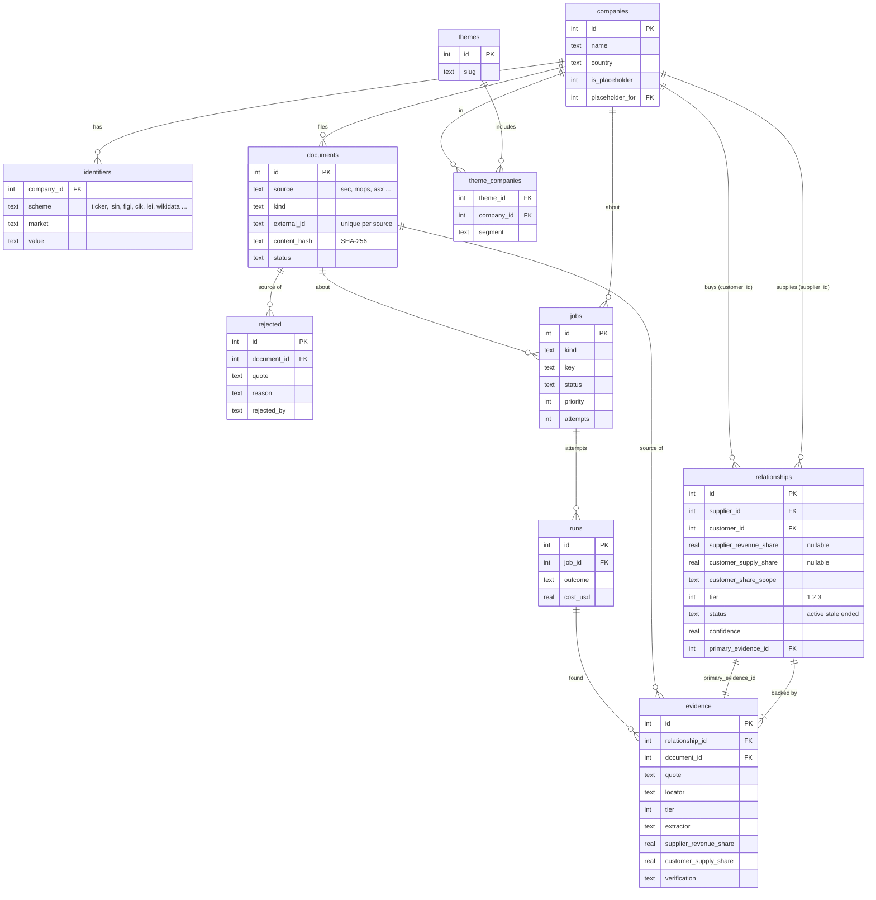

# Supply chain graph

Milestone 10 builds the foundation: a database of companies and who supplies whom, where every link
carries the evidence it came from. Milestone 11 fills it with AI extraction, 12 draws it, 13 adds an
analyst and a shared server. This page is the reference for the schema (#115) and the conventions every
later piece follows.

## Conventions

- **Direction.** A relationship is *supplier → customer*: the supplier sells to the customer.
- **Two dependencies, both optional.** Each is a percentage from 0 to 100 and NULL when no document says.
  - `supplier_revenue_share`: how much of the **supplier's** revenue comes from this customer
    ("Customer A was 23% of NVIDIA's revenue"). It shows how much the supplier depends on the customer.
  - `customer_supply_share`: how much of what the **customer** buys comes from this supplier, of
    `customer_share_scope` ("chips", "wafers", "everything it buys"). "TSMC makes all of Apple's chips" is
    100 with scope "chips". It shows how much the customer depends on one supplier, which is what an
    investor in the customer needs to see.
- **Every relationship has evidence.** An `evidence` row ties it to a `document`, with the exact quote, where
  in the document it was, the extractor, and the shares and date that statement gave. Each piece of evidence
  keeps its own shares; the relationship holds the current best (merged in #127).
- **Evidence tiers.** 1 = structured data (XBRL tags, published supplier lists), 2 = text read by an AI and
  verified, 3 = news. A relationship's tier is its best evidence's.
- **Nothing is deleted when a link ends.** Its status becomes `ended` (or `stale`), so a synced copy can be
  told. Candidates the verifier refuses go in `rejected`, with the quote and document, so they aren't extracted
  and checked again.
- **Unnamed customers.** Filings often say "Customer A". These become placeholder companies (`is_placeholder`,
  `placeholder_for` = the company whose filing used the label), hidden by default, so the evidence is kept and a
  resolver can link them to a real company later.
- **Time.** ISO 8601 text in UTC (`2026-10-25T09:30:00Z`); dates as `2026-10-25`. JSON is stored as text.

## How the evidence rule is enforced

The database refuses a relationship without evidence; it isn't left to the code that writes it.

- `relationships.primary_evidence_id` is required and is a **composite foreign key** to
  `evidence (relationship_id, id)`, so it must be evidence *for that relationship*.
- The key is **deferred**: both rows are written in one transaction (`graph.add_relationship`), and the commit
  fails if either is missing.
- `evidence.document_id` is required, so every piece of evidence names its source document.
- The primary evidence can't be deleted while it is primary (move it to other evidence first); deleting a
  relationship deletes its evidence.
- `supply_chain.integrity.check()` finds what's left: damage done from outside, such as a hand-edited file.

## Tables



- `identifiers`: one company has many (tickers per market, ISIN, FIGI, CIK, LEI, Wikidata); `(scheme, market, value)`
  is unique, so a ticker can't belong to two companies.
- `jobs`: at most one open (queued or running) job per `(kind, key)`; higher `priority` runs first.
- `runs`: one per attempt, with the model, tokens and `cost_usd`, so a daily budget is a sum.
- Migrations: `backend/supply_chain/migrations.py`, applied in order, each in a transaction, with a checksum
  so an edited old migration is noticed. The database is `supply_chain.sqlite` (in `data/`, or Application Support
  in the Mac app).

## Customer concentration from XBRL (#120)

10-Ks tag each "major customer" percentage as `us-gaap:ConcentrationRiskPercentage1`, with dimensions for the counterparty (`srt:MajorCustomersAxis`, or a supplier / vendor axis) and the benchmark (revenue, accounts receivable, purchases). `xbrl.import_filing` reads the filing's XBRL instance (`<doc>_htm.xml`) and label file (`_lab.xml`) and writes each figure as a relationship with **tier 1** evidence (extractor `xbrl`) pointing at the 10-K: the quote is the fact as tagged ("Apple, Inc.: 91% of revenue, 2025-03-30 to 2026-03-28 [us-gaap:ConcentrationRiskPercentage1, MajorCustomersAxis = crus:AppleIncMember]"), the locator the fact and context ids, `stated_on` the period end.

| Member | What happens |
|---|---|
| Unnamed ("Customer A", "Major Customer One", "Undisclosed Customer 1", "Supplier A", "Company A") | A placeholder company for the filer, one per label **and fiscal year** ("Customer A (unnamed customer of CoreWeave, Inc., year to 2025-12-31)"), because this year's Customer A need not be last year's. Never sent to the name lookup. |
| Named ("Apple, Inc.", "HP Inc.", "Dell Inc.") | The name resolver (#119). A match links the real company; anything else goes to `rejected` (`unresolved_company`), not guessed. |
| Group ("Top Ten Customers", "Three Largest Customers", "Ablecom and Compuware") | Left out: not one company. |
| Narrowed by a region or product line | Left out. A business segment is kept as a note. |

Benchmarks: a revenue share fills `supplier_revenue_share` (the filer supplies the counterparty); a purchases share means the counterparty is the filer's **supplier** and fills `customer_supply_share` with the benchmark as scope ("Supplier A: 63.1% of purchases, total" for Super Micro); a receivables share is kept as a `share_note` on the evidence only. Revenue and receivables figures of the same label and year are one relationship. Other benchmarks ("Manufacturer Concentration") are left out. The same figure tagged twice keeps the more precise one. `graph.refresh_shares` sets a relationship's shares from its newest evidence, so an older filing loaded later doesn't overwrite a newer figure.

The scout queues an `xbrl` job (priority 55) for every new 10-K that has XBRL data. 10-Qs (quarterly shares) and 20-Fs (IFRS tags) are not read yet.

## Cutting filings into chunks (#123)

Nothing here uses AI. `supply_chain/chunker.py` turns a downloaded filing into pieces the Reader (#124) sends to Claude, in three steps:

1. **Text.** The HTML (or plain text) becomes a list of cleaned paragraphs, numbered from 1. Tables stay readable as rows (`Beta Corp | 48%`), with EDGAR's separate `$` and `)` cells joined back to their numbers. The hidden XBRL header, scripts, page numbers and "Table of Contents" lines are dropped. A report laid out line by line (ASML's 20-F) has its lines joined back into sentences. The same file always gives the same numbers under the same rules, so a paragraph number in a locator keeps pointing at the same text; `CHUNKER_VERSION` names those rules and is part of every locator (`[chunker v1]`). Bump it whenever cleaning or section finding changes what a file gives.
2. **Sections.** A *section finder* keeps the passages that name business relationships and drops the rest (cover pages, exhibit lists, signatures). The SEC finder keeps:

   | Form | Kept |
   |---|---|
   | 10-K | Item 1 Business, Item 1A Risk Factors, Item 7 MD&A (only the paragraphs that mention customers, suppliers, vendors, distributors, foundries, sole source and similar, plus the paragraph either side), and the notes to the financial statements about revenue, segments, concentration, customers, suppliers, related parties, commitments and accounting policies (found under Item 8 or under Item 15, where many companies put the F-pages). A statements item with no recognisable notes is kept whole. |
   | 10-Q | Part I Item 1 (notes, as above), Part I Item 2 (MD&A passages), Part II Item 1A |
   | 20-F | Items 3, 4, 5 (passages), and the notes (as above) under Item 17, 18 or Item 8 Financial Information, where some 20-Fs put the statements |
   | 8-K | Item 1.01 (material agreement) and 1.02 (termination), plus attached exhibit 10.x agreements in full. An 8-K about something else (results, a director leaving) gives no chunks. |
   | 6-K, or a filing whose Items can't be found | The whole text, as the section "Full text". |

   Items are found by their headings. A table of contents lists the same headings, so of all the places an Item appears, the one with the most text under it is the real one, and a page header repeating "Item 1A (continued)" doesn't cut the section in two. Prose that merely mentions "Item 7 of this report" is not a heading. When the statements Item's own heading isn't found, the notes are looked for from the "Notes to consolidated financial statements" line.

   Notes are numbered in several ways: `Note 3 - Revenue`, `3. Revenue` / `3.Revenue`, `(3) REVENUE`, `3 - Revenue`, `C. REVENUE`, or the number alone on a line with the title on the next. The notes are the longest run numbered 1, 2, 3 ... in document order in one style, so a numbered list inside a note ("1.Identification of the contract"), a contents list or footnotes ("Note 1: Including ...") don't break or replace them; between runs of one length, the one whose headings aren't followed straight away by another heading wins.
3. **Chunks.** Each section is cut into chunks under `MAX_CHUNK_TOKENS` (80,000) at paragraph boundaries. A paragraph that is too big on its own is cut at line breaks (a long table between rows), then sentence ends, then spaces, and only a single word longer than the limit is cut anywhere. The next chunk starts with the end of the previous one (up to `OVERLAP_TOKENS`, 1,000, whole paragraphs only), so a relationship split across a boundary appears whole in one of them; `Chunk.overlap` says how many leading paragraphs are repeats. A chunk never spans two sections.

Why 80,000: `claude-haiku-5-5` costs 5 times more for a prompt over 100,000 tokens (`usage_store.PRICES`, `long_from`), and the Reader's instructions and answer need room. There is no local tokenizer, so `estimate_tokens` is deliberately high, fitted to Anthropic's own count (`messages.count_tokens`) of real chunks: a word costs one token per 3 letters, a word in capitals one per 1.33 letters, digits one per 3, and every symbol, line break and space before a number or symbol one. On 19 real chunks, from risk-factor prose to tables, it was 7 to 24% above the real count (mean 18%) and never below; the test keeps it at or above measured counts of digit groups, money, percentages, table rows, line breaks and capitals.

Each `Chunk` has the file name (`document`), the `section`, the `text`, the estimated `tokens`, `first_paragraph` / `last_paragraph` and a `locator` such as `Item 1A. Risk Factors, paragraphs 7-10`, which is what evidence points at. The Reader's quote can be found again by loading the same file and reading those paragraphs.

**Other sources.** A finder is a function `(paragraphs, form) -> list[Section] | None` registered with `@chunker.finder("source")`: `None` means "can't tell" (the whole text is used), `[]` means "I read the structure and nothing matters". MOPS, EDINET, DART and ASX PDFs (#128 to #131) bring their own loader for the paragraphs and their own finder, then call `chunk_paragraphs(paragraphs, source, form, document)`.

`chunk_filing(folder, form, primary_document)` chunks a whole download folder. The scout downloads only the main document so far, so exhibit 10.x files are chunked only once something downloads them (#322).

**Checking it on real filings.** `backend/scripts/chunk_report.py` (development only) prints, for every filing in `data/filings`, the sections, chunk count and estimated tokens, and flags a 10-K or 20-F without risk factors or customer / concentration / segment / geographic notes, and a 10-K read as Full text; `--fetch` first downloads a sample of AI hardware filings (27 annual reports, 3 10-Qs, 8-Ks with Item 1.01). On 38 filings (26 Oct 2026) two are flagged and are read whole: Intel's 10-K has no Item headings at all (topic headings and a cross-reference index), and ASML's 20-F is its integrated annual report without Item headings. `backend/scripts/token_calibration.py` compares the estimate with `messages.count_tokens` for the most prose-heavy and table-heavy chunks (needs `ANTHROPIC_API_KEY`; counting is free).

## Running it and watching it (#122)

Settings > Supply chain pipeline has the **Run pipeline** switch (off by default: it uses the user's Anthropic key when it reads reports with Claude), a **monthly budget** in US dollars (default US$10) and a status line with **Open pipeline…**, which opens the pipeline sheet. The switches are kept in `pipeline_settings.json` next to the database (`supply_chain/control.py`); until someone chooses, "run" follows `PIPELINE` in `.env`.

The supervisor in `worker.keep_running` checks every 5 seconds: workers run while the pipeline is on, not paused and this month's spending (the sum of `runs.cost_usd` since the 1st, UTC) is under the budget. When that stops being true the workers stop (the job in hand goes back in the queue, no attempt counted) and they start again by themselves, e.g. next month. It also loads the watch list from `seed/themes.json` at start.

The sheet (`GET /pipeline`, `/pipeline/companies`, `/pipeline/log`, built by `supply_chain/status.py`) shows only what the tables say: Coverage (watched companies whose latest filing is downloaded), Links (active relationships, new in 7 days, ended), Needs attention (jobs failed for good, plus ones waiting to retry) and Cost (month against budget). A company is *failed* if one of its jobs failed for good, *reading* while a job runs, *waiting* while jobs are queued (or not yet looked at), *up to date* when everything is done, and *not on EDGAR* when SEC has no filings for it. The log is built from runs (RUN, DONE, FAIL, SCOUT) and relationships (LINK). Retry requeues failed jobs (`POST /pipeline/retry`); Run now looks at every watched company again and resumes a pause.

## Matching names to companies (#119)

Filings name companies in their own words ("TSMC", "Micron Technology, Inc.", "Customer A"). `resolver.resolve(conn, name)` maps a name to a company, and says how:

1. **Identifier store**: a company in the graph with that name, or a stored alias (`name` identifiers).
2. **Index data**: S&P 500, Nasdaq 100, Dow and ASX members (names and tickers from `constituents.py`).
3. **OpenFIGI**: a name search (works without a key at 25 a minute; `OPENFIGI_API_KEY` raises it to 250); accepted only when every equity listing with that name belongs to one share class.

Names are compared after normalising (case, accents, punctuation, `&`/`and`, `N.V.`/`NV`, and endings such as Inc, Corp, Co, Ltd, Limited, plc, AG, SA removed) plus the alias list. Nothing looser: a name that merely *starts* with a known company ("Apple Operations International Limited") is skipped as a probable subsidiary, a name two different companies share is skipped as ambiguous, and "Customer A" is skipped as unnamed. Share classes (GOOG / GOOGL) count as one company when their company market cap is the same. At OpenFIGI, depositary receipts (ADRs) of the same name are the same company, and an answer without the name is retried without the legal ending ("Wistron Corporation" -> "wistron", "Lenovo Group Limited" -> "lenovo group"). Common names that differ from the legal one (Foxconn = Hon Hai Precision, TSMC, AMD, Amazon, Luxshare ...) are in `seed/aliases.json` with the company's ticker; the first time one is used it is stored as a `name` identifier (source `alias_list`) on the company (created if missing), so the store answers from then on. "Samsung" alone is left unmatched because it names a whole group. When OpenFIGI lists several share classes of one name, the one with at least three times the listings of the next is the company's primary listing (Lenovo: the Hong Kong shares and their dollar, euro and yuan counters); a closer call is still skipped as ambiguous.

Each decision is saved in `name_resolutions` (matched: `method`; skipped: `reason` and `detail`), with the identifiers that were learnt carrying the method as their `source`. The same name is not looked up twice; a skipped name is looked at again after 30 days. OpenFIGI being unreachable is not a decision and is not saved.

## Job queue and workers (#116)

Pipeline work is a **job** (`supply_chain/jobs.py`): a kind (`scout`, `download`, `read` ...) and a key (what it is
about). At most one open job exists per kind and key, so queueing the same work twice does nothing (except that the
more urgent priority wins). Workers (`supply_chain/worker.py`) claim jobs atomically, highest priority first, and
run the handler registered for the kind (`@handler("scout")`).

```
queued -> running -> done
                  -> queued again after a back-off (30 s, 2 min, 8 min ... up to 6 h) on an error
                  -> dead   when out of attempts (3 by default)
                  -> failed on a permanent error (the input is wrong)
```

- Every attempt writes a `runs` row (outcome, model, tokens, `cost_usd`), so a daily budget is one sum.
- **Survives restarts.** The queue is in the database. At start the runner takes back every job a previous
  process left running; on an orderly stop (the app quitting) the job in hand goes back without costing an
  attempt; after a crash the lost attempt counts, so a job that kills its worker every time ends up dead.
- Several workers can run side by side (`PIPELINE_WORKERS`, default 2). Only one runner process should use a
  database. A worker only claims kinds it has a handler for.
- **Off by default**: `PIPELINE=1` in `.env` starts the workers with the app, because they download filings and
  spend AI budget.

## What comes next

| Issue | Piece | Uses |
|---|---|---|
| #116 | job queue and workers (done) | `jobs`, `runs` |
| #117 | SEC client (done; `sec_client.py`, shared with the boards job; `supply_chain/sec.py` registers and downloads filings) | `documents` (hash, status) |
| #121 | AI hardware seed (done; 59 companies in `backend/seed/themes.json`, loaded by `supply_chain/themes.py`) | `companies`, `identifiers`, `themes` |
| #119 | name resolver (done; `supply_chain/resolver.py` + `openfigi.py`) | `identifiers` |
| #118 | SEC scout (done; `supply_chain/scout.py`: watches theme companies for 10-K, 10-Q, 8-K and queues downloads) | `themes`, `documents`, `jobs` |
| #120 | XBRL customer concentration (done; `supply_chain/xbrl.py`) | `relationships`, `evidence`, placeholder companies |
| #122 | pipeline status sheet (done; Settings group + `PipelineSheet.jsx`, `supply_chain/status.py`, `control.py`, `routers/pipeline.py`) | counts of `jobs`, `runs`, `documents` |
| #123 | document chunker (done; `supply_chain/chunker.py`) | `documents.local_path` in, chunks out |
| M11 | reader, verifier, orchestrator, merge | `evidence`, `rejected`, `runs.cost_usd`, `relationships.confidence` |
| M12 | graph API and explorer | indexes on both ends of `relationships`; chains of up to three layers by a recursive query |
| M13 | server, export, sync | plain SQL (Postgres), `updated_at`, `ended` instead of deletes |
